<!-- Profile README for @deanyadid09-cmyk. Black theme. Edit PROFILE in _src/build.py and run `python _src/build.py` to regenerate the panels. -->

Product builder working on AI systems and automation. Currently building **DealEngine** for Draw Forward LLC. 
<a href="https://github.com/deanyadid09-cmyk?tab=repositories">Repositories</a> · <a href="https://github.com/deanyadid09-cmyk">Follow</a>

